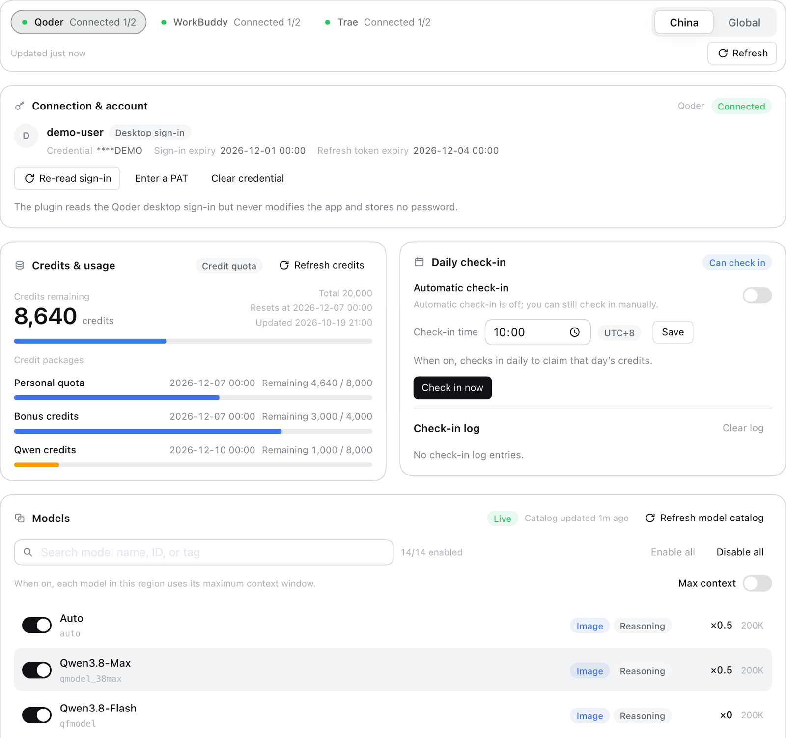
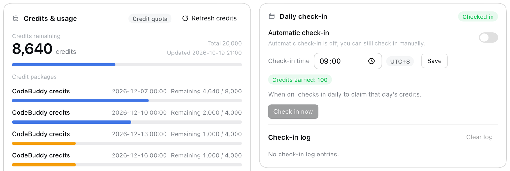
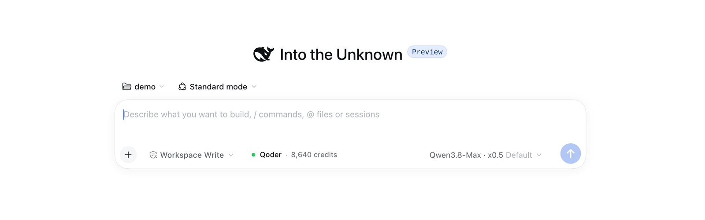

# dsh-connect-hub

[简体中文](./README.md) | English

[](./LICENSE)
[](https://www.npmjs.com/package/@deepseek-ai/dsh)
[](https://github.com/DaozeTang/dsh-connect-hub/releases)

A DeepSeek Harness (DSH) plugin that brings **Qoder, WorkBuddy and Trae** models into one model
picker, sharing a single credential store, cache, scheduler and settings page.

The plugin reuses the sign-in already saved by the local official desktop apps, so there is usually
nothing to sign in again and no token to paste. Qoder also accepts a Personal Access Token (PAT) as a
fallback.



> An unofficial community project, not affiliated with Qoder, WorkBuddy, Trae, DeepSeek or their
> operators. For study and research; read the [disclaimer](#disclaimer) before use.

## Features

| Capability | Qoder | WorkBuddy | Trae |
|---|---|---|---|
| Automatic desktop sign-in import (no pasted token) | yes (macOS; Windows experimental) | yes | yes |
| Model catalog (live / cached / built-in) | yes | yes | yes |
| Model visibility, bulk toggles, search | yes | yes | yes |
| Context window (default / upstream maximum) | yes | yes (Global only) | yes |
| Multiplier / promotion badges | yes (multiplier only) | yes | yes (multiplier only) |
| Credits, subscription and package details | yes | yes | yes |
| Daily check-in (custom time, UTC+8) | yes | yes (China, while the official activity runs) | yes (China, once per device per day) |
| Reasoning probes (explicit consent) | — | yes | yes |
| Multi-account switch, import, export | — | — | yes |

All three families share the same experience:

- **One model picker**: six providers grouped by service (Qoder / Qoder Global, WorkBuddy /
  WorkBuddy AI, Trae / Trae Global); switching the region in the settings page switches the model
  source.
- **One scheduler**: credential polling, catalog refresh, quota refresh, daily check-in and
  reasoning probes each have a single instance, so several open pages never duplicate requests.
- **One credential store**: the DSH credentials service when available, a `0600` private file
  otherwise. Plaintext tokens never reach settings, logs, errors or status documents.

## Interface

The settings page lives at **Plugins → dsh-connect-hub**: switch between Qoder / WorkBuddy / Trae,
then between China and Global. A region only shows the features its provider actually supports.

- One connection card: identity → actions → explanation. The account, credential source and expiry
  appear once, with a tag for desktop sign-in / manual PAT / account import; a signed-out provider
  keeps just the connection, models and preferences cards.
- The models card supports per-model toggles, search, enable-all / disable-all, max context and
  multiplier / promotion badges.
- The credits, check-in and probes cards show remaining credits (points) and packages, check-in
  settings and log, and the most recent probe result.
- Composer credit readout: shown only while the current session model comes from this plugin; it can
  sit in the toolbar or above the composer, opens details with a refresh action, and its seat is
  configurable under Interface preferences.
- Light and dark themes follow DSH; empty, loading and error states are consistent across families,
  and both Chinese and English copy are provided.

WorkBuddy daily check-in card:



Composer credit readout:



> The screenshots use demo data and contain no real account information.

## Install

Requirements:

- DSH `0.2.1-rc.2` (the peer dependencies are pinned to this prerelease; stable and later rc
  releases are not supported yet)
- Node `^22.19.0 || >=24.0.0`
- pnpm (only to build from source)
- The official desktop clients you want to use, installed and signed in (WorkBuddy AI for the global
  edition)

```sh
git clone https://github.com/DaozeTang/dsh-connect-hub.git
cd dsh-connect-hub
pnpm install
pnpm run build
dsh plugin --profile desktop add "$PWD"
```

Restart DSH, then open **Plugins → dsh-connect-hub**: connection state, credits, models, check-in and
probes all live on that page. TUI and headless compositions are supported too: without a web server
only the providers register, models stay usable and the settings page appears when a browser surface
is available.

> A Desktop release may manage its profile itself; follow its rules for installing and removing
> plugins instead of bypassing its checks. To update a source install, run
> `pnpm install && pnpm run build` again and restart DSH; saved preferences are kept. An installation
> without a saved credential imports the desktop sign-in on first boot, and saving a PAT or clearing
> the credential turns automatic import off.

Not on npm yet; once published, `dsh plugin --profile desktop add dsh-connect-hub` works directly.

## Configure

### Qoder

- By default the plugin imports the sign-in saved by the local Qoder desktop app (Keychain on macOS,
  DPAPI on Windows), so no PAT is needed. While the desktop sign-in is in use it also compares the
  app record periodically (read-only) to follow a re-sign-in or account switch.
- The imported tokens become the plugin's own copy and are rotated near expiry; the rotated pair is
  written back only to the plugin's credential store, never to the app, which is not signed out or
  modified.
- "Enter a PAT" accepts a Personal Access Token generated at qoder.com.cn (China) or qoder.com
  (global). It is verified against its own region before saving, a failed check is never stored, and
  saving one turns automatic import off.
- "Clear credential" removes only the plugin's copy and never signs the desktop app out; the plugin
  can then re-import the app sign-in or use a PAT again. The first read may ask macOS for Keychain
  access; see the [FAQ](#faq).
- Automatic import is implemented for macOS and Windows only; use a PAT on Linux.

### WorkBuddy

- No configuration needed: the hub reuses the signed-in WorkBuddy (China) or WorkBuddy AI (global)
  desktop app.
- The China edition supports the official daily "Buddy" check-in: while the activity is running the
  settings page shows a check-in card for a manual claim, a configurable automatic time (UTC+8) and
  the claim log.
- After switching accounts in the app, use "Re-read sign-in"; credits also refresh on startup, on a
  sign-in change and on a timer.
- Desktop sign-in reading relies on the app's private storage interface. macOS and Windows locate
  the app automatically; Linux or a non-default install location needs the official Electron
  executable to be specified (see below), otherwise the read fails.

### Trae

- Reuses the local Trae / TRAE SOLO sign-in. Accounts can be switched, refreshed with "Re-read
  accounts", imported and exported.
- Check-in is per-device once per day, and the UI distinguishes "checked in" from "device slot
  already used"; the global edition has no check-in.
- Account import shows a redacted preview first and writes only after the region is confirmed. An
  exported file contains sign-in tokens: use it only to migrate to another device and never share it.

### Environment variables

| Variable | Purpose |
|---|---|
| `DSH_CONNECT_HUB_DATA_DIR` | Override the plugin data directory (default `<profile>/.dsh-connect-hub/`) |
| `DSH_CONNECT_HUB_QODER_CN_AUTH_FILE` / `DSH_CONNECT_HUB_QODER_GLOBAL_AUTH_FILE` | Point the Qoder China / global reader at a non-default sign-in file |
| `DSH_CONNECT_HUB_WORKBUDDY_AUTH_FILE` / `DSH_CONNECT_HUB_WORKBUDDY_AI_AUTH_FILE` | Point the WorkBuddy / WorkBuddy AI reader at a non-default sign-in file |
| `DSH_CONNECT_HUB_WORKBUDDY_ELECTRON_BIN` / `DSH_CONNECT_HUB_WORKBUDDY_AI_ELECTRON_BIN` | Point the helper at the official WorkBuddy / WorkBuddy AI Electron executable for non-default installs |
| `DSH_WORKBUDDY_POLL_MS` | WorkBuddy desktop sign-in poll interval (default 30 s, 1 s–24 h) |

## Privacy and security

- All plugin-owned files live under `<profile>/.dsh-connect-hub/` (`DSH_CONNECT_HUB_DATA_DIR`
  overrides it): `preferences.json` holds model visibility, check-in settings and log, probe consent
  and similar preferences; `state/` holds rebuildable catalog caches plus Qoder device identity
  seeds; `secrets.json` is only a fallback for when the DSH credentials service is unavailable.
- Credentials go to the DSH credentials service when available (scope `dsh-connect-hub`), else a
  `0600` private file. Settings, preferences, caches and logs never contain plaintext tokens.
- The browser HTTP surface accepts local peers only (loopback or one of the machine's own interface
  addresses); `Host` is checked and a present `Origin` must match. Writes additionally require a
  per-process control key, are body-size capped and rate limited. Status documents contain masked
  account facts only.
- The plugin runtime loads no external fonts or assets and performs no telemetry or update checks;
  only the three providers' own endpoints are contacted.
- The WorkBuddy credential helper runs the official Electron binary as a child process with a
  minimized environment: the key is read from the child's stdout into memory, never passed on argv
  or through a shell, under a timeout and an output cap.
- Qoder desktop-login import opens the app's encrypted sign-in record read-only and decrypts it in
  memory through the OS credential store (macOS Keychain / Windows DPAPI). Key material and plaintext
  never reach logs, argv or a shell, and the app's own storage is never written back. The OS may show
  a Keychain permission prompt (once per item, per DSH process, on the first read).
- The Trae account export is the only user-triggered action that produces a token-bearing file; the
  import flow shows a redacted preview and requires region confirmation first.
- Known boundary: local processes are outside the threat model, as with any loopback app; the browser
  surface is local-only, so DSH bound to a non-loopback address cannot serve it to remote browsers.

Security regression tests cover the route guard, credential storage, loopback shims, import
validation, child-process environment, lifecycle and repository hygiene; the Qoder desktop-sign-in
reader is additionally covered by hermetic tests that inject every OS call:

```sh
pnpm exec vitest run tests/security
```

## FAQ

**Why does Qoder ask for macOS Keychain permission so often?**

The Qoder desktop app encrypts its sign-in record and keeps the decryption key in the system Keychain
(`Qoder App Safe Storage` / `Qoder CN App Safe Storage`). The plugin can only ask the OS for that key
read-only, so macOS prompts for approval. Choose "Always Allow" and enter the login password once;
"Allow" alone may be asked again on the first automatic read of each new DSH process. China and
Global are separate items and can each prompt once. Windows uses DPAPI and shows no prompt; Linux
does not support automatic import, so use a PAT. Saving a PAT under "Enter a PAT" turns automatic
import off.

**Where is the WorkBuddy check-in, and why is its card sometimes missing?**

WorkBuddy (China) has an official daily "Buddy" check-in, and the hub supports it: while the activity
is running and the account can take part, the settings page shows a check-in card for a manual claim,
an automatic daily time (UTC+8) and the claim log. The activity is opened in official
seasons; when the service reports it as unavailable the card hides.

**Do quota refreshes consume credits?**

A quota query can be billed upstream, so it happens only on plugin start / first initialization, a
sign-in or account change, a manual refresh or the configured poll interval. Catalog reads and status
rendering never issue billable requests.

**Why is the composer credit readout missing?**

The readout appears only while the current session model comes from this plugin. Its seat (toolbar or
above the composer) is configurable under Interface preferences.

**How do I remove the plugin completely?**

Remove the plugin first (DSH plugin manager, or
`dsh plugin --profile desktop remove dsh-connect-hub`), then delete the plugin data directory
(default `<profile>/.dsh-connect-hub/`, or `DSH_CONNECT_HUB_DATA_DIR` when set). Qoder additionally
offers "Clear credential" to remove its DSH credentials-service record before removal; WorkBuddy and
Trae have no such button, and their plugin copies are removed with the data directory. Removing the
plugin never signs out a desktop client and never deletes the app's own sign-in.

## Known limitations

- Trae: image input follows the upstream `multimodal` flag (no per-model toggle); both regions are
  always registered and an unused region renders empty; the upstream Raw Chat channel is permanently
  disabled, leaving SOLO; check-in exists for China only, once per device per day.
- WorkBuddy: check-in depends on the official "Buddy" activity and the card hides when it is not
  running or the account cannot take part; the global edition has no check-in yet, needs the
  WorkBuddy AI app, and enterprise quota was verified for China only; the China edition has no
  max-context switch and the action fails explicitly instead of silently doing nothing.
- WorkBuddy desktop sign-in reading relies on the app's private storage interface; Linux or a
  non-default install location needs the Electron executable specified, and an internal format
  change is reported honestly.
- Qoder: PAT validation reports pass/fail only, so a network failure and a rejected token share one
  message and nothing is stored either way; desktop-login import covers macOS and Windows only (the
  Windows DPAPI path has not been exercised on a real device, and Linux uses a PAT) and points to
  the PAT alternative when the read fails.
- The finite host warning codes, credit plan/package labels and Trae edition labels are localized in
  both languages. Free-form upstream text (catalog/usage error details, check-in log rows, package
  names sent by the service) is displayed as received and may remain in its original language.

## Development

```sh
pnpm install
pnpm run typecheck   # host and browser type checks
pnpm test            # unit, integration and client tests
pnpm run build       # builds lib/index.js and lib/client.js
pnpm run check       # all of the above
```

The code is grouped as `src/client` (settings page and composer readout), `src/core` (credentials,
preferences, scheduler and HTTP route), `src/providers` (the three protocols) and `src/shared`
(types shared by host and browser); `tests/security` holds the security regressions and `tests/live`
the optional read-only regressions against real accounts.

Helper scripts:

- `scripts/dev-server.sh [port] [dsh-home]` creates a disposable `hub-test` profile and serves it.
- `PUPPETEER_FROM=<profile package.json> node scripts/screenshot.mjs <url> <out.png>` captures the
  plugin page with headless Chrome (`CHROME_PATH` for a non-default binary).
- Read-only live regression:
  `HUB_LIVE_PROFILE=<profile dir> HUB_LIVE_HOME=<dsh home> pnpm exec vitest run tests/live`
  (except `qoder-desktop-live`, which rotates tokens and sends one very short chat; run it only
  against a test account).

Questions, suggestions and pull requests are welcome in
[Issues](https://github.com/DaozeTang/dsh-connect-hub/issues); run `pnpm run check` before sending a
patch.

## Disclaimer

This is an unofficial community project. It is not affiliated with, endorsed by, or cooperating
with Qoder, WorkBuddy, Trae, DeepSeek or their operators; all names and trademarks belong to their
respective owners.

- The plugin works through the vendors' desktop apps and their undocumented interfaces, which may
  change, be restricted, or be shut down at any time. The plugin may stop working or behave
  unexpectedly, and no continued availability is promised.
- Use only accounts you own and are entitled to use, and comply with each service's terms,
  subscription agreement, and applicable law. You are responsible for any account restriction,
  suspension, credit loss, data damage, or other consequence of using this plugin.
- Model calls, credit usage, and check-in rewards follow each platform's actual rules and billing;
  the authors make no guarantee about costs, credits, or rewards.
- The software is provided "as is", without warranty of any kind, express or implied. To the
  maximum extent permitted by law, the authors and contributors are not liable for any direct or
  indirect loss arising from the use of, or inability to use, this software.
- Do not use the plugin to bypass payments or access controls, bulk-register accounts, or automate
  abuse in violation of any service's terms; you are responsible for any consequence of such use.
- Exported account files contain sign-in tokens; keep them safe. You are responsible for any loss
  caused by sharing, leaking, or mishandling them.

## License

MIT. See [LICENSE](./LICENSE).
