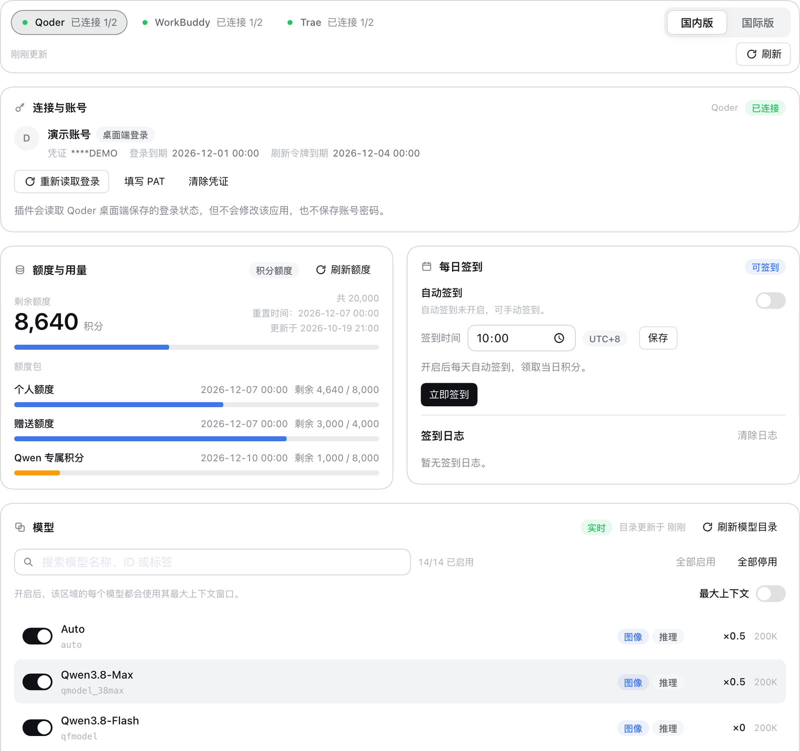
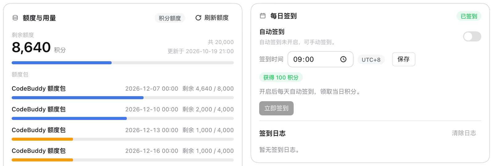
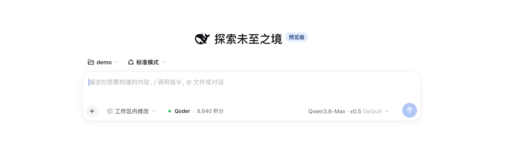

# dsh-connect-hub

简体中文 | [English](./README.en.md)

[](./LICENSE)
[](https://www.npmjs.com/package/@deepseek-ai/dsh)
[](https://github.com/DaozeTang/dsh-connect-hub/releases)

一个 DeepSeek Harness（DSH）插件：把 **Qoder、WorkBuddy、Trae** 三个平台的模型接入同一个模型
选择器，共用一套凭证、缓存、定时任务与设置界面。

插件直接复用本机已登录的官方桌面端，通常不需要重新登录或粘贴令牌；Qoder 另外提供
Personal Access Token（PAT）作为备选。



> 非官方社区项目，与 Qoder、WorkBuddy、Trae、DeepSeek 官方无关联。仅供个人学习研究，
> 使用前请阅读[免责声明](#免责声明)。

## 功能

| 能力 | Qoder | WorkBuddy | Trae |
|---|---|---|---|
| 桌面端登录自动读取（无需粘贴令牌） | ✓（macOS；Windows 实验性） | ✓ | ✓ |
| 模型目录（实时 / 缓存 / 内置三级降级） | ✓ | ✓ | ✓ |
| 模型开关、批量开关、搜索 | ✓ | ✓ | ✓ |
| 上下文窗口（默认 / 上游最大值） | ✓ | ✓（仅国际版） | ✓ |
| 倍率 / 优惠徽章 | ✓（仅倍率） | ✓ | ✓（仅倍率） |
| 额度、订阅与套餐明细 | ✓ | ✓ | ✓ |
| 每日签到（可自定义时刻，UTC+8） | ✓ | ✓（国内版，官方活动期内） | ✓（国内版，按设备每天一次） |
| 推理档位探测（需显式授权） | — | ✓ | ✓ |
| 多账号切换、导入导出 | — | — | ✓ |

三家共用同一套体验：

- **一个模型选择器**：六个 provider 按服务分组（Qoder / Qoder 国际版、WorkBuddy / WorkBuddy AI、
  Trae / Trae 国际版；英文界面为 Qoder Global / Trae Global），在设置页切换国内版 / 国际版即切换
  模型来源。
- **一套后台任务**：凭据轮询、目录刷新、额度刷新、每日签到和推理档位探测各自只有一个实例，
  打开多个页面不会重复请求。
- **一套凭据存储**：优先写入 DSH credentials 服务，服务不可用时才退化为权限 `0600` 的私有文件；
  设置、日志、错误和状态文档中永不出现明文 token。

## 界面

设置页在 **插件 → dsh-connect-hub**：顶部切换 Qoder / WorkBuddy / Trae，区域内再切换国内版 /
国际版，每块只显示该 provider 真正支持的功能。

- 连接卡片统一为「账号身份 → 操作 → 说明」：账号、凭证来源与到期时间只出现一次，来源标签区分
  桌面端登录 / 手动 PAT / 账号导入；未登录时只保留连接、模型与偏好。
- 模型卡片支持单个启用、搜索、全部启用 / 停用、最大上下文与倍率 / 优惠徽章。
- 额度、签到与探测卡片分别显示剩余额度（积分）与套餐、签到设置与日志、最近一次探测结果。
- 输入框额度读数只在当前会话模型来自本插件时出现，可停在工具栏或输入框上方，点击查看详情并
  刷新；位置在「界面偏好」里切换。
- 跟随 DSH 的明暗主题与中英文界面，空态、加载态与错误态统一。

WorkBuddy 每日签到卡片：



输入框额度读数：



> 配图使用演示数据，不含真实账号信息。

## 安装

前置条件：

- DSH `0.2.1-rc.2`（peer 依赖锁定该预发布版本；stable 与后续 rc 尚未适配）
- Node `^22.19.0 || >=24.0.0`
- pnpm（仅从源码构建时需要）
- 已安装并登录需要使用的官方客户端（WorkBuddy 国际版需要 WorkBuddy AI）

```sh
git clone https://github.com/DaozeTang/dsh-connect-hub.git
cd dsh-connect-hub
pnpm install
pnpm run build
dsh plugin --profile desktop add "$PWD"
```

重启 DSH 后进入 **插件 → dsh-connect-hub**：连接状态、额度、模型、签到与探测都在这一页。
TUI / headless 组合下只注册 provider，模型照常可用，设置页在有浏览器界面时显示。

> Desktop 发行版可能自行管理 profile，安装与卸载以其规则为准。从源码更新时重新执行
> `pnpm install && pnpm run build` 并重启 DSH；已保存的偏好会保留。没有保存过凭据的安装会在
> 首次启动时自动读取桌面端登录，保存 PAT 或清除凭据即可关闭自动登录。

尚未发布到 npm；发布后可直接 `dsh plugin --profile desktop add dsh-connect-hub`。

## 配置

### Qoder

- 默认自动读取本机 Qoder 桌面端登录（macOS 走系统钥匙串、Windows 走 DPAPI），无需 PAT；
  使用桌面端登录期间会只读比对桌面端记录，以跟随重新登录或切换账号。
- 读取到的令牌会成为插件自己的副本，临近过期时自动续期；续期只写插件自己的凭据存储，不修改
  Qoder 桌面端，也不会让桌面端退出登录。
- 也可以点「填写 PAT」粘贴 Personal Access Token（国内版在 qoder.com.cn、国际版在 qoder.com 的
  账号设置中生成）。保存前会向对应区域校验，失败不落盘；保存 PAT 会关闭自动读取。
- 「清除凭证」只删除插件侧副本，不会退出桌面端；之后可以重新读取桌面端登录或改用 PAT。首次读取
  时 macOS 可能请求钥匙串授权，见[常见问题](#常见问题)。
- 自动读取目前只覆盖 macOS 与 Windows；Linux 请使用 PAT。

### WorkBuddy

- 无需配置，直接复用已登录的 WorkBuddy（国内版）或 WorkBuddy AI（国际版）桌面端。
- 国内版支持官方「Buddy 加油站」每日签到：活动期间设置页会出现签到卡片，可手动签到、设置每日
  自动签到时间（UTC+8），并查看签到日志。
- 在 App 内切换账号后点「重新读取登录」；额度会在启动、登录状态变化和定时轮询时刷新。
- 桌面登录读取依赖官方 App 的私有存储接口：macOS / Windows 会自动定位 App；Linux 或非默认安装
  位置需要显式指定官方 Electron 可执行文件（见下方环境变量），否则读取会失败。

### Trae

- 复用本机 Trae / TRAE SOLO 的登录；账号表里可以切换账号，点「重新读取账号」刷新列表，也可以
  导入导出账号。
- 签到按「每台设备每天一次」判定，界面会区分「已签到」与「本机名额已用」；国际版不提供签到。
- 账号导入会先展示脱敏预览，确认区域后才会写入；导出的文件包含登录令牌，只用于迁移到另一台
  设备，请妥善保管、不要分享。

### 环境变量

| 变量 | 作用 |
|---|---|
| `DSH_CONNECT_HUB_DATA_DIR` | 覆盖插件数据目录（默认 `<profile>/.dsh-connect-hub/`） |
| `DSH_CONNECT_HUB_QODER_CN_AUTH_FILE` / `DSH_CONNECT_HUB_QODER_GLOBAL_AUTH_FILE` | 指定 Qoder 国内版 / 国际版桌面登录记录的位置 |
| `DSH_CONNECT_HUB_WORKBUDDY_AUTH_FILE` / `DSH_CONNECT_HUB_WORKBUDDY_AI_AUTH_FILE` | 指定 WorkBuddy / WorkBuddy AI 桌面登录文件的位置 |
| `DSH_CONNECT_HUB_WORKBUDDY_ELECTRON_BIN` / `DSH_CONNECT_HUB_WORKBUDDY_AI_ELECTRON_BIN` | 指定 WorkBuddy / WorkBuddy AI 官方 Electron 可执行文件（非默认安装位置） |
| `DSH_WORKBUDDY_POLL_MS` | WorkBuddy 桌面登录轮询间隔（默认 30 秒，1 秒–24 小时） |

## 隐私与安全

- 全部自有文件集中在 `<profile>/.dsh-connect-hub/`（`DSH_CONNECT_HUB_DATA_DIR` 可覆盖）：
  `preferences.json` 保存模型开关、签到设置与日志、探测授权等偏好；`state/` 放可重建的模型目录
  缓存与 Qoder 设备标识种子；`secrets.json` 仅在 DSH credentials 服务不可用时作为凭据后备。
- 凭据优先保存为 DSH credentials 服务的持久记录（scope `dsh-connect-hub`），服务不可用时才写入
  权限 `0600` 的私有文件。配置、偏好、缓存与日志永远不含明文 token。
- 浏览器 HTTP 路由只接受**本机来源**（回环地址或本机网卡地址），校验 `Host`，并在 `Origin`
  存在时校验其是否匹配；写操作另需每进程随机控制键，请求体有大小上限和频率限制；状态响应只含
  脱敏后的账号信息。
- 插件运行时不加载外部字体 / 图片，也无遥测与更新检查；只请求三家服务自身的接口。
- WorkBuddy 凭据解密会把官方 Electron 可执行文件以子进程方式启动：子进程只拿到最小环境变量，
  密钥仅经 stdout 读入内存，不进 argv、不经过 shell，且有超时与输出上限。
- Qoder 桌面端登录只以只读方式打开加密记录，并通过系统凭据库（macOS 钥匙串 / Windows DPAPI）
  在内存中解密；密钥与明文不写日志、不进 argv、不经过 shell，也不回写桌面端。必要时系统可能
  弹出钥匙串授权（每个条目、每个 DSH 进程首次读取时一次）。
- Trae 账号导出是唯一由用户主动触发生成含令牌文件的动作；导入会先展示脱敏预览并确认区域。
- 已知边界：本机其他进程不在防护范围内（回环应用的共同前提）；请勿在不可信的多用户机器上运行；
  浏览器界面仅本机可用，DSH 绑定非回环地址时远端无法访问。

安全回归测试覆盖路由防护、凭证存储、回环转发端点、账号导入校验、子进程环境、生命周期与仓库
卫生；Qoder 桌面登录读取另有注入全部系统调用的封闭测试：

```sh
pnpm exec vitest run tests/security
```

## 常见问题

**Q：Qoder 读取登录时为什么经常弹出 macOS 钥匙串授权？**

Qoder 桌面端把登录记录加密存放，解密密钥在系统钥匙串里（`Qoder App Safe Storage` /
`Qoder CN App Safe Storage`），插件只能只读请求该密钥，所以 macOS 会要求授权。选「始终允许」
并输入一次登录密码即可，之后不再反复询问；只点「允许」则每个 DSH 进程首次读取可能再问一次。
国内版与国际版是两个条目，可能各问一次。Windows 走 DPAPI 无此提示；Linux 请用 PAT。不想让插件
读取桌面端时，保存 PAT 即可关闭自动读取。

**Q：WorkBuddy 的签到在哪里？为什么有时看不到签到卡片？**

WorkBuddy 国内版有官方「Buddy 加油站」每日签到，插件已接入：活动进行中且账号可参与时，设置页
会显示签到卡片，可手动签到或配置每天自动签到（UTC+8），并记录签到日志与积分。签到活动由官方
按活动周期开放；接口返回活动不可用时卡片会隐藏。

**Q：刷新额度会消耗积分吗？**

额度查询可能产生上游的计费查询，所以只在插件启动 / 首次初始化、登录或账号变化、手动刷新和
定时轮询时发生；模型目录读取与状态渲染不会产生计费请求。

**Q：为什么输入框里看不到额度读数？**

读数只在当前会话选中的模型来自本插件时出现；位置可以在「界面偏好」里切到工具栏或输入框上方。

**Q：怎么彻底移除插件？**

先移除插件（DSH 插件管理，或 `dsh plugin --profile desktop remove dsh-connect-hub`），再删除插件
数据目录（默认 `<profile>/.dsh-connect-hub/`；如果设置过 `DSH_CONNECT_HUB_DATA_DIR`，删除该目录）。
Qoder 另外提供「清除凭证」，可在移除前先删除 DSH credentials 服务中的记录；WorkBuddy 与 Trae
没有该按钮，其插件副本会随数据目录删除。移除插件不会退出任何桌面客户端，也不会删除桌面端自己
的登录。

## 已知限制

- Trae：图片输入按上游 `multimodal` 标注自动声明（无逐模型开关）；两个区域始终注册，未使用
  区域为空；Raw Chat 上游长期关闭，只保留 SOLO；签到仅国内版且按设备每天一次。
- WorkBuddy：签到依赖官方「Buddy 加油站」活动，活动不可用或账号不可参与时卡片隐藏；国际版
  暂未接入签到，且需要 WorkBuddy AI App；企业额度仅国内版验证；国内版没有「最大上下文窗口」
  开关，该动作会明确返回失败而不是静默无效。
- WorkBuddy 桌面登录读取依赖官方 App 的私有存储接口；Linux 或非默认安装位置需手动指定 Electron
  可执行文件；App 改动内部格式时界面会如实显示失败。
- Qoder：PAT 校验只区分「通过 / 不通过」，网络故障与令牌失效共用提示且失败不落盘；桌面登录
  自动读取仅覆盖 macOS 与 Windows（Windows 的 DPAPI 实现尚未在真实设备回归，Linux 请用 PAT），
  读取失败时会提示改用 PAT。
- 有限集合的宿主警告码、额度套餐名与 Trae 版本标签提供中英双语；上游自由文本（目录 / 额度错误
  详情、签到日志、服务端返回的套餐名）按原样展示，可能保留其原始语言。

## 开发

```sh
pnpm install
pnpm run typecheck   # 宿主与浏览器端类型检查
pnpm test            # 单元、集成与客户端测试
pnpm run build       # 构建 lib/index.js 与 lib/client.js
pnpm run check       # 以上全部
```

代码按 `src/client`（设置页与输入框读数）、`src/core`（凭证、偏好、调度与 HTTP 路由）、
`src/providers`（三家协议）和 `src/shared`（共享类型）组织；`tests/security` 覆盖安全回归，
`tests/live` 是可选的只读真实账号回归。

辅助脚本：

- `scripts/dev-server.sh [port] [dsh-home]`：创建一次性的 `hub-test` profile 并启动 Web 界面。
- `PUPPETEER_FROM=<profile package.json> node scripts/screenshot.mjs <url> <out.png>`：用无头 Chrome
  打开插件页截图（非默认 Chrome 路径用 `CHROME_PATH` 指定）。
- 真实账号只读回归：`HUB_LIVE_PROFILE=<profile dir> HUB_LIVE_HOME=<dsh home> pnpm exec vitest run tests/live`
  （`qoder-desktop-live` 例外：它会轮换令牌并发起一次极短对话，只应在测试账号上运行）。

问题、建议与 PR 欢迎提到 [Issues](https://github.com/DaozeTang/dsh-connect-hub/issues)；提交前请
先跑一遍 `pnpm run check`。

## 免责声明

本项目是非官方社区项目，与 Qoder、WorkBuddy、Trae、DeepSeek 及其关联公司没有隶属、合作或
背书关系；相关名称与商标归各自所有者。

- 插件依赖各平台桌面端及其未公开接口工作，这些接口可能随时变更、限制或关闭，插件可能因此
  失效或表现异常，作者不承诺持续可用。
- 请仅使用你本人拥有并有权使用的账号，并遵守各平台服务条款、订阅协议与当地法律。因使用本
  插件导致的账号限制、封禁、额度损失、数据损坏或其他后果，由使用者自行承担。
- 模型调用、额度消耗与签到奖励以各平台实际规则和计费为准，作者不对任何费用、额度或收益作
  保证。
- 软件按「原样」提供，不附带任何明示或暗示的担保。在法律允许的最大范围内，作者与贡献者
  不对因使用或无法使用本软件产生的任何直接或间接损失承担责任。
- 请勿将本插件用于绕过付费或访问控制、批量注册、自动化滥用等违反服务条款的用途；由此产生
  的责任由使用者自行承担。
- 导出的账号文件包含登录令牌，请妥善保管；因分享、泄露或保管不当造成的损失由使用者自行
  承担。

## 许可

MIT。见 [LICENSE](./LICENSE)。
